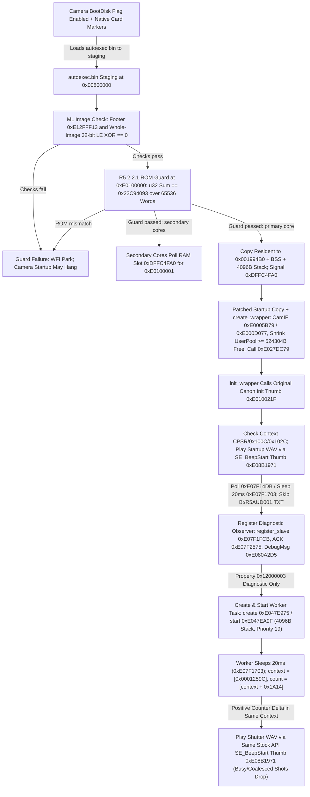

# Canon R5 Sound Mod

**Source-preview resident audio modification for the original Canon EOS R5 on firmware `2.2.1` only.**

It plays a user-supplied **Startup** WAV clip when the camera finishes Canon's initialization sequence and a separate user-supplied **Shutter** WAV clip through the camera's built-in speaker when the release counter advances on a single-shot capture.

> [!WARNING]
> **Source / Developer Preview — Not a Turnkey Installer or Full Magic Lantern Port**
> - This repository contains **source code and documentation only** — no prebuilt binaries, no Canon ROM/FIR files, and no copyrighted or private audio assets are distributed.
> - You must supply your own `64 MiB` EOS R5 `2.2.1` ROM dump, your own converted `48 kHz` mono 16-bit PCM WAV files, and a camera that already has its persistent `BootDisk` flag enabled.
> - **The public repackaged source build has not itself been hardware-tested.** Its native C/ASM/linker implementation is copied from a private lab baseline (`build36`, `562,144` bytes, SHA-256 `3579cecf0ab9349035b4d4320ceb6e7fe34719f15f00bc80e0d34bbdf3b312c2`) that was user-confirmed on an original EOS R5 `2.2.1` in mechanical single-shot mode on a `16 GB` SDHC FAT32 card.

---

## Support Matrix

| Target Model / Firmware | Status | Notes |
| --- | --- | --- |
| **Canon EOS R5 (original), Firmware `2.2.1`** | **Experimental Source Preview** | Baseline `build36` user-confirmed for Startup + mechanical single-shot Shutter playback on `16 GB` SDHC FAT32; returned logs from `build36` are uninspected. |
| Canon EOS R5, other firmware versions | **Unsupported** | Requires separate firmware-specific ROM dump, immutable code fingerprints, and verified bindings. **Never downgrade** or cross-flash. |
| Canon EOS R5 C / EOS R5 Mark II | **Unsupported** | Different hardware/firmware; never run EOS R5 `2.2.1` binaries on these bodies. |
| Canon EOS R6 / R6 Mark II / R6 Mark III | **Unsupported** | Requires a separate target-specific port and read-only recon; never cross-flash R5 binaries. |

See [docs/porting.md](docs/porting.md) for what an independent port requires.

---

## Quickstart

Full prerequisites, ROM acquisition guidance, card preparation notes, and recovery limits are in **[docs/usage.md](docs/usage.md)**.

### Clone the Source

```sh
git clone https://github.com/WhiteAvocad0/canon-r5-sound-mod.git
cd canon-r5-sound-mod
python3 -m unittest discover -s tests -v
```

The standalone tests use synthetic inputs; the C behavior tests also require an existing host C compiler such as Clang or GCC. No camera or ROM dump is needed to run those unit tests.

### 1. Prerequisites

- **Python**: `>= 3.11` (standard library only; no automatic package downloads).
- **Toolchain**: Explicit GNU Arm `15.2.1` reference toolchain directory containing `arm-none-eabi-{gcc,ld,nm,objcopy,objdump,readelf}` (e.g., xPack GNU Arm Embedded GCC `15.2.1-1.1`).
- **Audio converter** (optional, for converting source clips): existing host `ffmpeg`.
- **User-supplied inputs**:
  - Your own `64 MiB` EOS R5 `2.2.1` ROM dump (`0xE0000000..0xE4000000`).
  - Two separate `48 kHz`, mono, 16-bit signed little-endian PCM WAV files: one for **Startup** and one for **Shutter**.

### 2. Prepare Your Audio Clips

The repository includes **no** bundled recordings (no Windows XP or Mambo clips) and applies **no** normalization or trimming. Convert your own audio separately with `ffmpeg`:

```sh
ffmpeg -i startup-source.mp3 -map 0:a:0 -ac 1 -ar 48000 -c:a pcm_s16le startup-48k-mono.wav
ffmpeg -i shutter-source.mp3 -map 0:a:0 -ac 1 -ar 48000 -c:a pcm_s16le shutter-48k-mono.wav
```

The builder embeds each clip in its own immutable 32-byte-aligned buffer (zero-padding only the tail up to a 32-byte DMA boundary). **Maximum clip length is enforced by the actual reserved memory guard, not an arbitrary seconds limit:** resident code, BSS, `4,096`-byte private stack, descriptors, and both padded PCM buffers combined must stay below `FW_OBJECTS_START` (`0x002AC218`) while leaving at least `524,304` bytes (`0x80010`) of Canon user memory free out of the `1,125,744`-byte pool starting at `0x001994A8`. Exceeding that budget fails the build's memory guard.

### 3. Build Offline

Run the portable offline builder (it never contacts a camera or writes removable media):

```sh
python3 tools/build.py \
  --rom /path/to/eos-r5-221-rom.bin \
  --startup-wav /path/to/startup-48k-mono.wav \
  --shutter-wav /path/to/shutter-48k-mono.wav \
  --toolchain /path/to/arm-none-eabi-15.2.1/bin \
  --output build/my-r5-sound
```

This selects the baseline `shutter-feedback` feature profile and produces:

- `autoexec.bin` — ML-formatted boot payload for a pre-prepared `BOOTDISK` card.
- `build.json` — provenance, SHA-256 digests, memory reservation bounds, and input fingerprints.
- `symbols.json` & linker `.map` — exact resident symbol addresses for this specific build.

Next, follow **[docs/usage.md](docs/usage.md)** for card backup, native `EOS_DEVELOP`/`BOOTDISK` marker preparation (using a reviewed workflow, not blind `dd`), copying `autoexec.bin`, and camera testing.

---

## How It Works

### Address Classification

Every address in this project belongs to a distinct category. Do not mix them:

- **ROM Thumb entry (odd address, bit 0 = 1)**: Fixed Canon EOS R5 `2.2.1` executable entry points in `0xE0000000..0xE3FFFFFF` (e.g., `0xE010021F`, `0xE08B1971`).
- **ROM region / guard target (even address)**: Firmware base or checksummed code window (e.g., `0xE0100000`).
- **Fixed RAM slot**: Fixed RAM pointer location in Canon's `2.2.1` memory map (e.g., `0x0001259C` for the release-counter context pointer, `0xDFFC4FA0` for the secondary-core hold slot).
- **Field offset**: Byte offset added to a dereferenced RAM object pointer (e.g., `+0x1A14` from the counter context pointer).
- **Property ID**: 32-bit Canon property identifier passed to the property observer (e.g., `0x12000003` release diagnostic, `0x80000023` Beep setting).
- **Resident private addresses (build-dependent)**: Symbols inside `0x001994B0.._reserved_end` (private code, descriptors, embedded PCM, BSS, and stack) **shift whenever audio clip lengths or code change**. Always read your own build's `symbols.json` and `.map` rather than hardcoding private addresses.

### Boot, Handoff, and Playback Flow



1. **Image Convention & ROM Guard**: The `0xE12FFF13` footer and whole-image 32-bit LE XOR check are a Magic Lantern image-integrity convention, **not** Canon cryptographic authentication. Before copying anything to resident RAM, `check_image` sums `65,536` 32-bit words (`256 KiB`) starting at `0xE0100000` (`FW_MAIN_START`) and halts in `wfi` if the sum does not equal `0x22C94093`.
2. **Resident Pool Handoff**: The primary core copies the resident section to `0x001994B0` (`FW_RESIDENT_BASE`), clears BSS and the `4,096`-byte private stack, releases secondary cores waiting on `0xDFFC4FA0` with `0xE0100001`, and runs a RAM copy of Canon's startup block (`0xE0100000..0xE0101000`) with `create_wrapper` hooked in before `FW_INIT_FACTORY` (`0xE027DC79`). `create_wrapper` reserves `0x001994A8.._reserved_end` from Canon's user pool while enforcing at least `524,304` bytes remaining below `0x002AC218`.
3. **Startup Playback & Observer**: After original Canon init (`0xE010021F`) returns, `init_wrapper` checks that IRQs are enabled and Canon task/lock flags (`0x100C`, `0x102C`) are ready, verifies stock audio-readiness slots, and submits the **Startup** descriptor to `SE_BeepStart` (`0xE08B1971`), polling `0xE07F14DB` every `20 ms` (`0xE07F1703`). The default `shutter-feedback` profile skips writing `B:/R5AUD001.TXT` to avoid duplicate FAT directory entries across reboots, then registers the `R5O2` property observer (`0xE07F1FCB` / `0xE07F2575` / `0xE080A2D5`, where release property `0x12000003` is diagnostic only and Beep `0x80000023` dumps `R5O2` diagnostics).
4. **Shutter Worker Loop**: `sound_boot_start_worker` spawns `"r5shutter"` (`create_task` `0xE047E975`, `start_task` `0xE047EA9F`, `4096`-byte stack, priority `19`). Every `20 ms` (`0xE07F1703`), the worker reads the guarded release-counter pointer at RAM slot `0x0001259C` plus field offset `+0x1A14`. Initial reads, context changes, or counter resets only re-seed the baseline; a positive advance in the same context invokes the **Shutter** descriptor through the same stock `SE_BeepStart` API (`0xE08B1971`) with an immediate single readiness check (`readiness_limit = 1`). Busy or coalesced shots are dropped cleanly without queued delayed playback.

See [docs/addresses.md](docs/addresses.md) for the complete typed table of fixed addresses, audio readiness slots, and `build36` example resident offsets.

---

## Community Testing and Ports

Original EOS R5 `2.2.1` owners who meet the boot-enabled prerequisites can submit an [R5 test report](https://github.com/WhiteAvocad0/canon-r5-sound-mod/issues/new?template=r5-test-report.yml). Include the build hash, shutter mode, card filesystem and observed results.

For R6 / R6 Mark II / R6 Mark III, start with a [port request](https://github.com/WhiteAvocad0/canon-r5-sound-mod/issues/new?template=port-request.yml) and the [porting guide](docs/porting.md). Each needs its own verified firmware bindings before on-camera testing. Do not run the R5 payload on these cameras.

## Documentation Index

- **[docs/usage.md](docs/usage.md)** — Prerequisites, ROM dump provenance, audio conversion, card preparation (`16 GB` SDHC FAT32 baseline), camera usage, diagnostics, and recovery.
- **[docs/addresses.md](docs/addresses.md)** — Complete typed address reference for EOS R5 `2.2.1` (ROM Thumb entries, RAM slots, field offsets, property IDs, and `build36` example resident symbols).
- **[docs/sdxc.md](docs/sdxc.md)** — `128 GB` SDXC / exFAT migration status, bootloader `fs_type == 4` facts, known upstream checksum defect, and remaining hardware unknowns.
- **[docs/porting.md](docs/porting.md)** — Technical requirements for porting to other firmware versions or models (R5 C, R5 Mark II, R6 family).
- **[.github/ISSUE_TEMPLATE/](.github/ISSUE_TEMPLATE/)** — Structured templates for R5 `2.2.1` test reports and independent port requests.

---

## Disclaimer & Evidence Boundaries

- **Experimental software — use at your own risk**: This is an experimental resident firmware modification with limited testing. It may hang, trigger Canon asserts, lose or corrupt card data, or require recovery.
- **No warranty & no Canon affiliation**: Provided under `GPL-2.0-or-later` (see [LICENSE](LICENSE)) without warranty of any kind. Not affiliated with, endorsed by, or supported by Canon Inc.
- **Persistent BootDisk flag**: The camera's internal `BootDisk` flag persists across card formatting and card removal. This repository provides **no** guaranteed safe installer, uninstaller, or flash/NVRAM writer.
- **Recovery scope**: On the reference R5 `2.2.1` camera, removing the experimental card and power-cycling without it restored normal camera startup (user-confirmed), but that observation is **not** a brick-proof guarantee for every failure mode.
- **Unverified modes & behaviors**: Only mechanical single-shot capture on a `16 GB` FAT32 SDHC card has user-reported functional success (`build36`; returned card logs uninspected; prior `build29` logs verified release counter `113072 -> 113073 -> 113074` across two new CR3 frames). **Burst shooting, movie recording, blocked shots, card errors, measured physical audio latency, shutdown margin, and an immediate mute control are unverified.** Do not interpret the `20 ms` worker polling interval as measured physical sound latency. Current playback finishes naturally; overlapping/busy triggers drop rather than interrupting or queueing.
