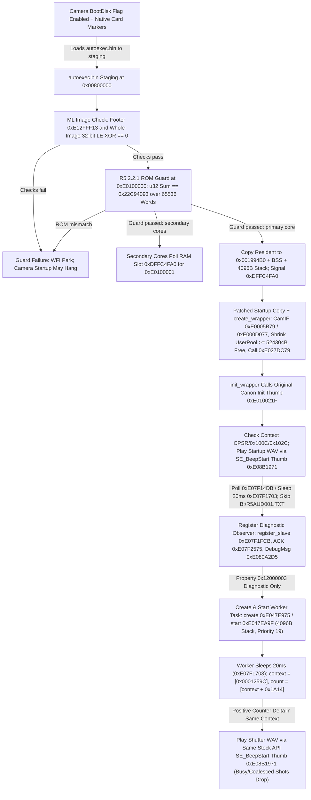

# Canon R5 Mod

**Source-preview resident firmware modifications for the original Canon EOS R5 on firmware `2.2.1` only.**

This repository provides two separate offline-buildable profiles for `BOOTDISK`-enabled EOS R5 `2.2.1` cameras:

1. **`shutter-feedback` (default)** — Plays a user-supplied **Startup** WAV clip after Canon initialization and a separate user-supplied **Shutter** WAV clip through the built-in speaker when the release counter advances on single-shot capture.
2. **`xpan-crop` (experimental, silent by default)** — Replaces the `16:9` aspect option with a **`2.71:1` (`512:189` ~ `2.709:1`) XPan** crop mode (`8192x3024` Large JPEG, `8192x5464` CR3 RAW with crop `(0, 1220, 8192, 3024)`), live LCD/EVF framing bars, Quick Control (`Q`) `"XPan"` label, playback masking and immediate XPan bars in the automatic post-shot review. Added startup/shutter audio is disabled (`0` WAVs, `0` mod audio/PCM code linked); Canon's own Beep setting is unchanged. The opt-in `--record-indicator ding` adds a generated cue on the Movie REC press.

> [!WARNING]
> **Source / Developer Preview — Not a Turnkey Installer or Full Magic Lantern Port**
> - This repository distributes **source code and documentation only** — no prebuilt binaries, no Canon ROM/FIR files, and no copyrighted audio/font/photo assets.
> - You must supply your own `64 MiB` EOS R5 `2.2.1` ROM dump and a camera whose persistent `BootDisk` flag is already enabled.
> - **The public `shutter-feedback` build is hardware-untested.** The public `xpan-crop` build with `--record-indicator ding` (image `0adff001`) passed a short owner check on 18 November 2026. The public `ding` + `dong` image `01956513` (built from `f4b2848`) passed a short owner check on 18 November 2026 (boot, live XPan framing, immediate review bars, a Full-frame control, the ding and dong over several takes, no dong in the played clip, the AF beep); `ding`-only and `dong`-only images from this version are new images and hardware-untested. Other "working" items below were observed on the owner's private lab builds (see the Proof Matrix).

---

## Feature Status

### Working (confirmed on the owner's private lab builds)

- [x] **XPan `2.71:1` crop mode** (`xpan-crop`): an XPan option replacing 16:9, with live LCD/EVF framing, immediate review bars, playback masking and saved XPan JPEG/RAW. See [docs/xpan.md](docs/xpan.md).
- [x] **Startup and shutter sounds** (`shutter-feedback`): your own clips through the camera speaker.
- [x] **Movie record indicator** ([#14](https://github.com/WhiteAvocad0/canon-r5-mod/issues/14)): start + stop cues, a short `ding` when you press Movie REC and a `dong` when the take ends (opt-in `--record-indicator ding`, `--record-stop-indicator dong`).
- [x] **One-press screenshot** ([#15](https://github.com/WhiteAvocad0/canon-r5-mod/issues/15)): RATE while a photo is shown in ▶ saves a 2400×1600 JPEG of the whole screen, made by Canon's own encoder (opt-in `--screenshot rate`); RATE in live view or a menu makes its JPEG by itself about 2.5–3 s after you next open ▶. See [docs/screenshot.md](docs/screenshot.md).
- [x] **Cards**: `16 GB` SDHC and `128 GB` SDXC exFAT, with CFexpress in the other slot.

Short owner checks have run on two public images (the `ding` image `0adff001` and the `ding` + `dong` image `01956513`); the public `--screenshot` image `809d3767` passed a short owner check on 22 November 2026; for screenshot anywhere, its automatic INFO and the JPEG-only XPan review fix ([#31](https://github.com/WhiteAvocad0/canon-r5-mod/issues/31)), this version has code identical to the public RC image `e2e7048d` checked on camera on 23 Nov 2026 (every object; only the source digest text differs); this exact image was not separately camera-run. See the [Support & Proof Matrix](#support--proof-matrix) for evidence.

### Planned / in progress

- [ ] [#12 29:59 recording-limit removal](https://github.com/WhiteAvocad0/canon-r5-mod/issues/12): a private build showed that the limit getter controls the auto-stop; a 59:59 test is pending.
- [ ] [#15 Screen recording](https://github.com/WhiteAvocad0/canon-r5-mod/issues/15): full-frame-rate recording isn't feasible on camera, but the R5's HDMI output to an external recorder is a practical route. (The one-press screenshot is above.)
- [ ] [#13 Live Photos](https://github.com/WhiteAvocad0/canon-r5-mod/issues/13): a host-side packager works on the Mac; the iPhone check is pending. Not in this repository.
- [ ] [#16 R5 Mod Assistant](https://github.com/WhiteAvocad0/canon-r5-mod/issues/16): a desktop *prototype* for building, preparing a camera-formatted card's boot markers (macOS; exFAT verified on the owner's Mac and camera, FAT32 untested) and copying without a terminal; see [docs/gui.md](docs/gui.md).
- [ ] [#7 Sound packs, volume and quick mute](https://github.com/WhiteAvocad0/canon-r5-mod/issues/7): host prototype only.
- [ ] Research only: [#5 anamorphic desqueeze](https://github.com/WhiteAvocad0/canon-r5-mod/issues/5), [#6 still-photo zebras/false colour/waveform](https://github.com/WhiteAvocad0/canon-r5-mod/issues/6), [#8 preset libraries](https://github.com/WhiteAvocad0/canon-r5-mod/issues/8), [#9 JSON colour recipes](https://github.com/WhiteAvocad0/canon-r5-mod/issues/9), [#10 exposure sequences](https://github.com/WhiteAvocad0/canon-r5-mod/issues/10), [#11 M-Film](https://github.com/WhiteAvocad0/canon-r5-mod/issues/11), [#4 HNCS-inspired profiles](https://github.com/WhiteAvocad0/canon-r5-mod/issues/4).
- [ ] [#1 R6-family ports](https://github.com/WhiteAvocad0/canon-r5-mod/issues/1): not started.

Details and evidence for each proposal are in [docs/research.md](docs/research.md).

---

## Support & Proof Matrix

| Target Model / Firmware | Profile | Status | Verified Evidence & Boundaries |
| --- | --- | --- | --- |
| **Canon EOS R5 (original), Firmware `2.2.1`** | `shutter-feedback` (default) | **Experimental Source Preview** | Private `build36` (`562,144` B, `3579cecf...`) user-confirmed for Startup + Shutter audio and normal photo capture on `16 GB` SDHC FAT32 and `128 GB` SDXC exFAT (returned SDXC photos/logs uninspected). **Public repackaged build: hardware-untested.** |
| **Canon EOS R5 (original), Firmware `2.2.1`** | `xpan-crop` (silent by default; opt-in record indicator) | **Experimental Source Preview** | On **17 November 2026**, the owner reported the four-case normal ▶ playback session working on private reference `4838eb81` / source `427bb28d`: rear-LCD landscape/portrait and EVF portrait/landscape, with control/display-switch checks. Returned diagnostics support crop projection and guide suppression. Earlier private trials confirmed menu/Q, live LCD/EVF and saved XPan output; the earlier 128 GB/CFexpress trial used an older build. On **18 November 2026**, private build `a7e92a3d` (on a 128 GB card) was reported working for immediate XPan bars in automatic review with the outline hidden for XPan only, stock Full-frame review, bursts, EVF, and the REC-press `ding`. **Public build** (`05e9612`, `--record-indicator ding`, `0adff001...`): owner-checked on 18 November 2026 on a 128 GB exFAT card for boot, live XPan framing, immediate XPan bars in automatic review, a Full-frame control and the REC `ding`. Normal ▶ playback and the EVF were not repeated on the public image. Private lab build `fbf31293` (`ding` plus record-stop `dong`) was owner-tested on 18 November 2026 ("confirmed that the dong works perfectly good"). The public `ding` + `dong` image `01956513` (built from `f4b2848`) passed a short owner check on 18 November 2026 (boot, live XPan framing, immediate review bars, a Full-frame control, the ding and dong over several takes, no dong in the played clip, the AF beep); `ding`-only and `dong`-only images from this version are new images and hardware-untested. On **22 November 2026**, private lab build-22 (on a 128 GB exFAT card) was reported working for the one-press screenshot: RATE in ▶ saved an all-layers 2400×1600 JPEG, with the screen-to-Y22 work at about 0.6 s. The public image `809d3767` (`ding` + `dong` + `--screenshot rate`) passed a short owner check that day: boot, XPan, both cues, and RATE in ▶ on 3:2 JPEG and RAW+JPEG photos saving all-layers JPEGs. RATE on an XPan photo is cancelled (three bips, a known limit). On **23 November 2026** the owner checked the public release-candidate image `e2e7048d` (`--record-indicator ding --record-stop-indicator dong --screenshot rate`, the same code as this version, including the JPEG-only XPan review fix of [#31](https://github.com/WhiteAvocad0/canon-r5-mod/issues/31)): boot, both cues, RATE in ▶, screenshot anywhere with the automatic INFO from live view and from a menu, and a joystick cancel followed by INFO worked, and the RAW+L XPan review was normal. One JPEG-only XPan review late in that long first session was stretched; it has not been reproduced and remains an open observation. A fresh-boot check (two JPEG-only XPan photos) and a full repeat of the session ending with three JPEG-only XPan photos were reported correct the same day. This version: code identical to the public RC image `e2e7048d` checked on camera on 23 Nov 2026 (every object; only the source digest text differs); this exact image was not separately camera-run. Other screenshot images are hardware-untested. |
| Canon EOS R5, other firmware versions | Any | **Porting / testing pending** | **Binary-incompatible.** Requires separate firmware-specific ROM dump, immutable code fingerprints, and verified bindings. **Never downgrade** or cross-flash. |
| Canon EOS R5 C / EOS R5 Mark II | Any | **Porting / testing pending** | **Binary-incompatible.** Different hardware/firmware; never run EOS R5 `2.2.1` binaries on these bodies. |
| Canon EOS R6 / R6 Mark II / R6 Mark III | Any | **Porting / testing pending** | **Binary-incompatible.** Requires target-specific port and read-only recon; never cross-flash R5 binaries. |

Community ports and firmware-specific validation are welcome. See [docs/porting.md](docs/porting.md) before any on-camera testing.

---

## Quickstart

> [!TIP]
> **New to this?** Start with the plain-language **[Getting started guide](docs/getting-started.md)**. It explains how the pieces fit together and walks through building, installing on a prepared card, testing and recovery.
>
> **Prefer a window to a terminal?** **[R5 Mod Assistant](docs/gui.md)** (*prototype*, `python3 tools/gui/app.py`) guides you step by step: camera check, ROM, BootDisk, features, build tools, build, boot card, copy and first test, with a check at every step and saved progress. On a Mac it can also prepare a card you formatted in the camera (backup first, one confirmation, Undo). The exFAT card path was verified on the owner's Mac and camera; FAT32 is untested. Its guided Canon Basic ROM-dump and BootDisk steps prepare a `<= 32 GB` FAT32 SDHC card for you to run in the camera and verify the returned dump or `gang200.bin`/`gang201.bin` readback (host-tested only; `DisableBootDisk` is hardware-untested). It runs the same builder and checks. You can [download it as an unsigned app](docs/gui.md#download-the-app) for macOS (`.dmg`, Apple Silicon or Intel) or Windows (`.zip`, x64, untested; card preparation stays macOS-only); desktop packages built from 0.2.0 include the GNU Arm toolchain for offline use. The earlier 0.1.0 package and source checkouts need a separate compiler.

Full prerequisites, ROM acquisition guidance, card preparation notes, and recovery limits are in **[docs/usage.md](docs/usage.md)**. For deep XPan internals, see **[docs/xpan.md](docs/xpan.md)**.

### Clone and Run Host Tests (No ROM or ARM Toolchain Needed)

```sh
git clone https://github.com/WhiteAvocad0/canon-r5-mod.git
cd canon-r5-mod
python3 -m unittest discover -s tests -v
```

Host tests use synthetic ROM/audio/KUWA fixtures and compile the actual C policy/worker code using an existing host C11 compiler (`cc`, `gcc`, or `clang`). No camera, ROM dump, or ARM toolchain is required for the default test suite.

### Prerequisites for Offline Target Builds

- **Python**: `>= 3.11` (standard library only; no automatic package downloads).
- **Toolchain**: Explicit GNU Arm `15.2.1` reference toolchain directory containing `arm-none-eabi-{gcc,ld,nm,objcopy,objdump,readelf}` (e.g., xPack GNU Arm Embedded GCC `15.2.1-1.1`).
- **User-supplied ROM**: Your own `64 MiB` (`67,108,864`-byte) EOS R5 `2.2.1` ROM dump (`0xE0000000..0xE4000000`).
- **For `shutter-feedback` (default) only**: Two separate `48 kHz`, mono, 16-bit signed little-endian PCM WAV files (`--startup-wav`, `--shutter-wav`), optionally converted with `ffmpeg`:
  ```sh
  ffmpeg -i startup-source.mp3 -map 0:a:0 -ac 1 -ar 48000 -c:a pcm_s16le startup-48k-mono.wav
  ffmpeg -i shutter-source.mp3 -map 0:a:0 -ac 1 -ar 48000 -c:a pcm_s16le shutter-48k-mono.wav
  ```

### Build Option A: Default `shutter-feedback` (Audio Mod)

```sh
python3 tools/build.py \
  --rom /path/to/eos-r5-221-rom.bin \
  --startup-wav /path/to/startup-48k-mono.wav \
  --shutter-wav /path/to/shutter-48k-mono.wav \
  --toolchain /path/to/arm-none-eabi-15.2.1/bin \
  --output build/my-r5-sound
```

### Build Option B: Experimental `xpan-crop` (Silent XPan, No Audio / No WAVs)

```sh
python3 tools/build.py \
  --profile xpan-crop \
  --rom /path/to/eos-r5-221-rom.bin \
  --toolchain /path/to/arm-none-eabi-15.2.1/bin \
  --output build/my-r5-xpan
```

Add `--record-indicator ding` to the same command for the opt-in movie record start cue, and `--record-stop-indicator dong` for the stop cue (no WAV files needed; both default `off`). See [docs/usage.md](docs/usage.md#movie-record-indicator---record-indicator). Add `--screenshot rate` for the opt-in one-press screenshot on the RATE button; see [docs/screenshot.md](docs/screenshot.md).

> [!NOTE]
> `--profile xpan-crop` is **silent by default (no audio)** and rejects `--startup-wav` / `--shutter-wav`. It derives `target-page.bin`, `frame_row_constants.h`, `menu-vector.bin`, and `feature-targets.h` into `--output` **only after** strict verification of R5 `2.2.1` immutable code, table, and vector resource fingerprints (`tools/contracts.py`), while admitting per-camera settings variance outside immutable code and recording your actual ROM SHA-256 as provenance.

Both commands never contact a camera or write removable media and produce `autoexec.bin`, `build.json`, `source-manifest.json`, `symbols.json`, and `handoff.map` inside `--output`. Next, follow **[docs/usage.md](docs/usage.md)** for card backup, existing `BootDisk` prerequisite checks, native `EOS_DEVELOP`/`BOOTDISK` card metadata, and recovery limits (no bootflag activator is provided; the only card writer is R5 Mod Assistant's opt-in boot-marker step).

---

## Let your coding agent guide you

Copy this prompt into an agent that can read this repository and inspect your computer. Replace the goal and any details you know; the agent should inspect what it can and ask only for missing information. The longer [agent-assisted setup guide](docs/agent-setup.md) explains the lessons behind the prompt.

```text
Help me use https://github.com/WhiteAvocad0/canon-r5-mod.
My goal is [silent XPan cropping / custom startup and shutter audio].
My camera model and firmware are [fill in, or ask me to check].
My computer/OS, card and input files are [fill in what I know].

Read this checkout's AGENTS.md, README.md, docs/usage.md,
docs/xpan.md and docs/agent-setup.md before proposing camera steps.
Use the documentation for the exact revision being built.

Confirm the exact model/firmware and the feature's current validation
scope. Do not run an R5 2.2.1 payload on another model or firmware,
downgrade the camera, disable target guards, or claim a full ML port.
Distinguish camera-tested private reference behavior from this public
repackaged source and any untested portrait/EVF playback paths.

Inspect installed tools and my supplied files. Run the documented
host checks and build offline with my own ROM and, for audio only,
my own WAV files. Preserve actual input hashes and build provenance.
Do not install unrelated software or upload my ROM, media or logs.
Keep the silent XPan and audio profiles separate.

Inspect the card's actual device identity, capacity, filesystem and
writability before preparing anything. Preserve existing files and
honor my backup instructions. This builder does not enable BootDisk
or prepare boot sectors; only R5 Mod Assistant's opt-in Prepare
card tab writes boot markers, when I choose it. Do not invent other
steps, format media, write camera flags, or force an unmount. If a required prerequisite
is unknown, explain it and continue only the independent offline work.
Respect authorization I have already given; ask before destructive
or persistent actions I have not authorized. Never ask me to paste
an administrator password into chat; wait through a local prompt.

Once a compatible card is prepared, read back the selected payload
and verify normal safe ejection before telling me to remove it.
Give me one short, ordered test session with a Full-frame control
and the documented XPan/audio cases. Record first-open behavior,
LCD/EVF and orientation explicitly. Test normal ▶ playback and
automatic post-shot review separately. Never equate successful host
preparation or sound playback with a successful crop test.

On return, acquire evidence before changing the card. Decode it
with the exact build's source-bound contract and retain every group;
physical log order is not chronology. If an error occurs, stop that
trial, follow the documented power-off/card-removal recovery, and
check normal operation before proposing another build. Report what
was observed, what was inferred, and what remains unverified.
```

---

## How It Works

### `shutter-feedback` Boot, Handoff, and Audio Flow



### `xpan-crop` Drawing, File, and Playback Pipeline

For `--profile xpan-crop`, the primary/secondary boot handoff places resident code at `0x001994B0` and constructs a build-dependent private MMU `TTBR1` root (`20` 4 KiB pages, `34` code patches, `10` L2 tables, `137` witness pages; `21/35/10/139` with either record indicator option) and routes aspect `7` (`16:9` -> `XPan`, `512:189`) across property `0x80040054`, menu vector `0xE38F614C`, Q label `0xE0B5D22C`, live framing `0xE20CFC64`, JPEG/RAW crop (`0xE0CD98DA`, `0xE017B61C`, `0xE098FB2C`), playback Main/tags/cache (`0xE0334E4C`, `0xE03141E4`, `0xE07732BE`, `O+0x34==0`), `fit` (`0xE0710D04`), native `Trim` (`0xE078DE84`), `guide` (`0xE06CBFD6` -> bail `0xE06CC061`), and the automatic-review fix (authority `0xE054C530`, outline `0xE0A956FE`, review descriptor `0xE063FBEE`). The opt-in record indicator adds one counter-only hook at `GUI_SetRecordingState` (`0xE07C6FBC`) and a worker step that submits a generated start and/or stop cue through `SE_BeepStart`. See the complete diagram and invariants in **[docs/xpan.md](docs/xpan.md)** and typed table in **[docs/addresses.md](docs/addresses.md)**.

---

## Community Testing and Ports

Original EOS R5 `2.2.1` owners who meet the boot-enabled prerequisites can submit:
- **[XPan Test Report](https://github.com/WhiteAvocad0/canon-r5-mod/issues/new?template=xpan-test-report.yml)** — report quality, display (`LCD`/`EVF`), orientation, first-open vs away/back behavior, `source_manifest_sha256`, and exact reproduction steps.
- **[R5 2.2.1 Test Report](https://github.com/WhiteAvocad0/canon-r5-mod/issues/new?template=r5-test-report.yml)** — report `shutter-feedback` audio or general R5 `2.2.1` host/hardware tests.
- **[Port Request](https://github.com/WhiteAvocad0/canon-r5-mod/issues/new?template=port-request.yml)** — start read-only recon for other R5 firmware versions or R5 C / R5 II / R6-family bodies per [docs/porting.md](docs/porting.md). Never run R5 `2.2.1` binaries on other cameras.

**Never upload Canon ROM dumps, `.FIR` updates, `.CR3`/`.JPG` photos, copyrighted audio clips, or raw SD card images.**

## Documentation Index

- **[docs/getting-started.md](docs/getting-started.md)**: Plain-language guide: how it works, building for your own camera, installing on a prepared card, first test, recovery and FAQ.
- **[docs/agent-setup.md](docs/agent-setup.md)** — Agent-assisted setup, evidence, card handling and testing lessons.
- **[docs/xpan.md](docs/xpan.md)** — Deep `xpan-crop` architecture, R5 `2.2.1` Mermaid pipeline, supported/declined view matrix, automatic-review fix, record indicator, and KUWA diagnostic decoding.
- **[docs/screenshot.md](docs/screenshot.md)** — The opt-in one-press screenshot (`--screenshot rate`): use, sounds, files on the card, how it works and its evidence boundary.
- **[docs/usage.md](docs/usage.md)** — Prerequisites, ROM provenance rules, audio conversion, offline build (`shutter-feedback` & `xpan-crop`), card preparation, and recovery.
- **[docs/addresses.md](docs/addresses.md)** — Complete typed R5 `2.2.1` address reference for boot, audio, observer, worker, and experimental XPan hooks/slots.
- **[docs/sdxc.md](docs/sdxc.md)** — `128 GB` SDXC / exFAT trial evidence, native marker/checksum derivation, and remaining validation.
- **[docs/research.md](docs/research.md)** — Open feasibility questions (#3 XPan, #4–#10, #11 MFilm, #12 29:59 record limit, #13 Live Photos, #14 movie record indicator, #15 screenshots and screen recording).
- **[docs/porting.md](docs/porting.md)** — Requirements for porting to other firmware versions or Canon models.
- **[.github/ISSUE_TEMPLATE/](.github/ISSUE_TEMPLATE/)** — Structured templates for XPan test reports, R5 `2.2.1` test reports, and port requests.

---

## Disclaimer & Evidence Boundaries

- **Experimental software — use at your own risk**: Resident firmware modifications may hang, trigger Canon asserts (`ERR70` or similar), lose or corrupt card data, or require recovery.
- **No warranty & no Canon affiliation**: Provided under `GPL-2.0-or-later` (see [LICENSE](LICENSE) and [THIRD_PARTY_NOTICES.md](THIRD_PARTY_NOTICES.md)) without warranty of any kind. Not affiliated with, endorsed by, or supported by Canon Inc.
- **Persistent `BootDisk` flag**: The camera's internal `BootDisk` flag persists across card formatting and card removal. This repository provides **no** turnkey bootflag activator, uninstaller, or flash/NVRAM writer.
- **Recovery scope**: On the reference R5 `2.2.1` body, removing the experimental card and power-cycling without it restored normal camera startup (user-confirmed), but that observation is **not** a brick-proof guarantee for every failure mode.
- **Unverified areas**: The public `shutter-feedback` build is hardware-untested. The public `xpan-crop` + `ding` image `0adff001` passed only the short 18 November 2026 check (boot, live XPan framing, immediate XPan bars in automatic review, a Full-frame control and the REC `ding`). The public `ding` + `dong` image `01956513` (built from `f4b2848`) passed a short owner check on 18 November 2026 (boot, live XPan framing, immediate review bars, a Full-frame control, the ding and dong over several takes, no dong in the played clip, the AF beep); `ding`-only and `dong`-only images from this version are new images and hardware-untested; the `dong` was owner-tested on private lab build `fbf31293`. For `shutter-feedback`: burst, movie, blocked shots, card errors, physical latency, shutdown margin, and immediate mute are unverified. For `xpan-crop`: private `4838eb81` normal ▶ playback passed the owner's four-case session, and private `a7e92a3d` passed the owner's automatic-review and REC-press `ding` checks; bursts deliberately keep the stock review, and the record indicator is quiet in recorded clips. Other qualities/modes (M/S/C-RAW/burst/movie), active auto-rotation (`r7 != 0`), and cached orientation values outside `{0, 2}` remain unverified or declined.
