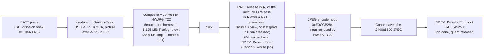

# One-Press Screenshot (`--screenshot`)

`--screenshot rate` is an opt-in option of the experimental `xpan-crop` profile, from issue [#15](https://github.com/WhiteAvocad0/canon-r5-mod/issues/15). It is **off by default**, and with it off the build links none of the code below.

When you press **RATE** while a photo is shown in ▶ playback, the camera saves a **2400×1600 JPEG of the whole screen**: the photo, the shooting information and every overlay. Canon's own JPEG encoder makes the file and saves it next to your photos, so ▶ can show it like any other JPEG.

RATE also works **anywhere else**, in live view or in a menu: the camera saves the screen at once and makes the JPEG the next time you press **INFO** in ▶ (see [Screenshot anywhere](#screenshot-anywhere-live-view-and-menus)).

> [!IMPORTANT]
> **Images with this version are hardware-untested.** The screenshot-anywhere behaviour (deferred JPEG at INFO, XPan photos through the last good photo) was owner-reported working on a private lab build on 22 November 2026, but no public image with it has run on a camera yet. The earlier public image `809d3767` (`--record-indicator ding --record-stop-indicator dong --screenshot rate`, without screenshot anywhere) passed a short owner check on 22 November 2026. Other option combinations and other cameras are untested. See [Evidence boundary](#evidence-boundary).

## Build

```sh
python3 tools/build.py --profile xpan-crop \
  --rom /path/to/eos-r5-221-rom.bin \
  --toolchain /path/to/arm-none-eabi-15.2.1/bin \
  --screenshot rate \
  --output build/r5-xpan-screenshot
```

It combines with the record cues (`--record-indicator ding --record-stop-indicator dong`). In R5 Mod Assistant, choose **One-press screenshot (RATE)** in the feature step.

**The SD card needs a folder `DCIM/R5SHOTS`**, next to the camera's photo folders in `DCIM`. The camera writes the screen files there and does not create the folder itself; without it every RATE gives one low bip and no screenshot. R5 Mod Assistant creates the empty folder when it copies a screenshot build to a camera-formatted card. With the command line, create it yourself.

## Using it

1. Press ▶ and show a JPEG photo **full screen**, not zoomed and not in the index grid.
2. Press **RATE** once and wait. The screen freezes for a moment while the camera saves the screen, then you hear a **click**.
3. About half a second later the new JPEG is on the card. It gets the next file number in the current folder, for example `IMG_0026.JPG` after `IMG_0025.JPG`.

If the photo shown is an XPan photo (or one Canon can't resize), the JPEG is made from the **last good photo** of this session instead: the last photo whose screenshot JPEG was saved since the camera was switched on. The screen in the JPEG is still the one you captured; only the file it is resized from changes. Without a last good photo you hear two low bips and the screenshot stays pending (see below).

What you hear:

| You hear | Meaning |
| --- | --- |
| a click | The screen was saved. In ▶ the JPEG follows about half a second later. |
| a click, then two low bips | No JPEG yet: neither the photo on screen nor a last good photo can be used (RAW only, HEIF, an earlier screenshot, a size Canon can't resize, or an XPan photo with no last good photo this session), or ▶ was left before RATE was released. The screen files were saved and the screenshot stays pending. With a deferred screenshot the two bips come at INFO, once per ▶ visit. |
| a click, then three low bips | The camera started the JPEG and cancelled it. |
| one low bip instead of the click | The screen could not be saved: `DCIM/R5SHOTS` is missing, the card is full or not ready, a photo was taken or saved less than about 2 s ago, the camera has only just started, or another screenshot is still being made. In ▶, two more bips may follow. |
| nothing | A movie is recording (screenshots stay silent then), or RATE was pressed again within about a second. |

A menu is drawn entirely in the on-screen display layer, so the [Screenshots tool](gui.md#screenshots) also turns a menu capture (`SS_n.YCA`) into a complete PNG of the menu.

### Screenshot anywhere (live view and menus)

1. In **live view** or a **menu**, press **RATE** once. You hear the click: the screen is saved, but no JPEG is made yet.
2. Within 9.5 minutes, press ▶ and wait until a photo is shown (about half a second).
3. Press **INFO** once. The JPEG of the earlier screen is made from the photo shown, as above (or from the last good photo, if the shown photo is XPan or can't be resized).

Details:

- **Only INFO starts it.** SET never does: it confirms the dialogs of ▶ (Erase, Protect, Q, Resize), and a screenshot must never start in the middle of one. Canon still handles the INFO press as usual (it changes the information display); that does not change the saved screen. Other buttons, and INFO outside ▶ or in the first half second of ▶, do nothing for the screenshot.
- **The latest RATE wins.** A newer RATE (anywhere) replaces a waiting screenshot; a RATE in ▶ is handled at once.
- **One JPEG per RATE.** After its JPEG is made, INFO does nothing more until the next RATE.
- **Two bips at INFO** mean no photo could be used (see the table). The screenshot keeps waiting: leave ▶, come back to a 3:2 JPEG photo and press INFO again. The bips come once per ▶ visit.
- **After 9.5 minutes** a waiting screenshot is dropped silently (no JPEG, no sound). Its `SS_` files stay on the card.
- While Canon or the camera is busy (a photo being written, another resize), INFO waits silently; press it again a moment later.

**Card speed matters.** Each RATE writes about 11 MB (about 18 MB from the viewfinder). On a fast 128 GB SDXC card the lab build's screen-to-Y22 work took about 0.6 s and the owner found the freeze short. On a slow 16 GB SDHC card the same work took about 2.1 s and the freeze felt like 2–3 s.

Press nothing else during the freeze, and after the click wait until the new image exists or the card LED is off.

## Files on the card

| File | Size | What it is |
| --- | --- | --- |
| `DCIM/<current folder>/<next number>.JPG` | about 0.5–1.5 MB | The screenshot: 2400×1600, made by Canon's encoder. |
| `DCIM/R5SHOTS/SS_nnnnn.YCA` | 2,095,616 B (5,760,512 B on the EVF) | The on-screen display layer (UYVA, 1024×682; 1600×1200 on the EVF). The [Screenshots tool](gui.md#screenshots) converts it to PNG. |
| `DCIM/R5SHOTS/SS_nnnnn.PIC` | 1,746,432 B (4,800,512 B on the EVF) | The picture layer under it (10-bit 4:2:2). |
| `DCIM/R5SHOTS/HWJPG.Y22` | 7,680,000 B | The 2400×1600 composite that the JPEG encoder reads. Overwritten by every RATE. |

The `SS_` files accumulate: delete them when you no longer need them.

## How it works



- **Three hooks.** The GUI dispatch hook (`0xE04A8028`) sees the RATE press and release, and the INFO release. The JPEG encode hook (`0xE0CCB284`, ShtVfxEncJpg_Encode) feeds `HWJPG.Y22` to the encoder instead of the resized photo whenever a 2400×1600 (S2) Resize is saved while an unused screenshot is pending (up to 10 minutes; see [Live view and manual Resize](#live-view-and-manual-resize)). The develop-end hook (`0xE0549258`) closes that job. Their pages and the pages of every Canon function the feature calls are admitted through `screenshot_code_fingerprints` in `config/xpan_target_contract.json`, only when `--screenshot` is selected.
- **The Y22 build.** The OSD row and the picture-layer row are composited and converted to the encoder's 2400×1600 Y/C layout. The work buffer is one 1,179,648-byte block borrowed from Canon's RscMgr pool (type 4, the pool Canon's GUI dialogs use) for the length of one build. If the pool cannot lend it within 200 ms (400 ms in the worst case), or lends an unusable block, the build falls back to 38,400-byte strips, which is slower but gives the same bytes. A block that arrives after the build stopped waiting is freed by its own callback.
- **The one-press job.** At the RATE release, the feature re-checks that ▶ is still shown and asks Canon's own Resize check whether the current photo can be resized (`FM_GetFileObjectForResize` on its JPEG sub-handle). Only then does it start `INDEV_DevelopStart` on that photo. Canon builds and names the new file as for an in-camera resize.
- **The source photo.** Before the Resize check, the feature reads the shown photo's aspect from ▶'s own cache (the same admitted AspectInfo reader the XPan playback masking uses). An XPan photo is never used: its S2 resize is 2400×1344, not the 3:2 the screenshot needs. If the photo is XPan or the Resize check refuses it, the job runs on the **last good photo** (the last view whose job saved this session), re-checked with the same Resize check. If neither works: two bips, and the screenshot stays pending. The dry run inside the job still refuses anything that is not exactly 2400×1600.
- **Deferred start.** A RATE outside ▶ marks its screenshot as waiting. The dispatch hook also passes the INFO release to the same GuiMainTask code, which starts the job there, in the same context and order as a RATE release, only when: no job is running and the feature is not latched off; ▶ is shown (re-read at that release) and has been shown for at least 0.5 s; `HWJPG.Y22` is still this RATE's; it is at most 9.5 minutes old (so the job always ends before the encode hook's 10-minute limit); and Canon's develop state and both busy flags are clear.
- **Feedback.** The click and the low bip are generated in the camera (`tone_ref.SCREENSHOT_CUES`, 33 ms and 40 ms) and played through Canon's speaker API (SE id 2) after the same readiness checks as the record cues. With the record indicator selected, a screenshot sound never interrupts a record cue.
- **Capacity.** A screenshot build has `37` hooks, `23` pages and `11` L2 tables, and admits `25` extra fingerprinted pages (`38/24/11` with the record indicator); the default build stays at `34/20/10`. The linked check refuses an image below Canon's heap floor. With the reference ROM a screenshot-only image leaves `834,904` bytes against the `524,304`-byte floor.

## Limits

- **SD card only.** The files go to the SD card (`B:`); the CFexpress slot is not used.
- **The JPEG is made in ▶ from a JPEG photo.** RAW-only and HEIF photos and earlier screenshots can't be the source; an XPan photo is replaced by the last good photo. The index view and zoom are not supported as sources. A RATE in live view or a menu needs INFO in ▶ afterwards (see [Screenshot anywhere](#screenshot-anywhere-live-view-and-menus)).
- **The last good photo exists only after one screenshot JPEG was saved from a 3:2 view in this session.** Right after power-on, a screenshot taken while an XPan photo is shown waits (two bips) until a 3:2 JPEG photo is shown at INFO or RATE.
- **Overlays only, sometimes.** If the picture layer can't be read (a format other than the full-range one, or a `.PIC` that could not be written), the JPEG shows the on-screen display without the photo.
- **XPan photos are never the source.** The screenshot replaces a Resize only when its output is exactly 3:2 (2400×1600, S2), and an XPan photo (8192×3024) can't produce one. The feature recognises an XPan photo from ▶'s cache before starting and uses the last good photo instead. If ▶'s cache has no recognised entry for the shown photo, Canon's Resize check and the dry run decide; an XPan photo then ends as before with three bips.
- **A card read error** while the encoder reads `HWJPG.Y22` can leave a JPEG that mixes the screenshot and the resized photo.
- **Not tested:** screenshot-only images (without the record cues), the EVF in ▶, the refusal and cancel bips on hardware (they never occurred), the late-block path (never seen; the block arrived in about 0.14 ms each time), movie playback screens, the 9.5-minute expiry, a deferred screenshot whose INFO comes while Canon is busy, and a screenshot from the Q screen over live view.

## Live view and manual Resize

A RATE whose screenshot did not become a JPEG (in live view or a menu, before INFO; or refused in ▶) leaves it pending for up to 10 minutes. Besides INFO in ▶, the next in-camera **Resize to S2** saved in that time (▶ → Playback menu → Resize, any 3:2 JPEG) produces the screenshot instead of the resized photo, and clears it. A Resize to another size, or after 10 minutes, is unaffected.

## Evidence boundary

- **Private lab builds (camera results).** On 22 November 2026 a private lab build first produced an all-layers 2400×1600 JPEG from one RATE in ▶; later lab builds added the borrowed block and its hardening. The last of them, build-22, ran on a 128 GB SDXC exFAT card: the Y22 build took 0.61 s, the screenshot had every layer, and the `HWJPG.Y22` left on the card was byte-identical to a host reconstruction from the same `SS_n` files. The owner reported "both are fast".
- **Public image check.** The public image `809d3767` (built from this branch with `--record-indicator ding --record-stop-indicator dong --screenshot rate`) passed a short owner check on a 128 GB exFAT card on 22 November 2026:
  - boot, XPan and both record cues;
  - RATE in ▶ on a 3:2 JPEG and on a 3:2 RAW+JPEG photo: one click each and an all-layers 2400×1600 JPEG;
  - RATE on an XPan JPEG: a click and three bips, see [Limits](#limits);
  - RATE in live view: a click, with the leftover `HWJPG.Y22` byte-identical to a host reconstruction.
- **Screenshot anywhere (private lab build, owner-reported on 22 November 2026).** On the 128 GB card: a live-view RATE gave its screenshot after INFO in ▶; a menu RATE gave its screenshot after INFO while an XPan photo was shown (through the last good photo); RATE on an XPan photo in ▶ gave a screenshot instead of three bips; a full-frame control worked. Every new JPEG was 2400×1600. That lab build had INFO as the only deferred start key, as here.
- **This public version.** The screenshot-anywhere code is the lab build's code with its diagnostics compiled out. Compiling those lab sources with that build's flags, minus the log file and the lab's review-crop diagnostic, gives `one_press`, the dispatch hook and every other screenshot object instruction-for-instruction equal to the public ones, apart from `combo_capture.c`'s `sound()` (the public record-cue readiness check and SE id) and `combo_capture_gui` (the two review fixes of the first port, below), and the source digest text. Images with this version are **hardware-untested**; default, `ding` and `ding` + `dong` builds keep identical code (their images differ only in the source digest text).
- **The first public port.** The C and assembly are the lab build-22 feature code with its diagnostics compiled out, plus two small fixes from review (a stale `.PIC` is removed before use; a shot recorded during RATE's own tick still counts as recent). Compiling the lab sources with build-22's flags, minus the log file, gives objects instruction-for-instruction equal to the public ones, except the click/bip `sound()`, which now uses the public record-cue engine's readiness check, and the two review fixes in `combo_capture_gui`. Default, `ding` and `ding` + `dong` builds keep identical code, and their images differ only in the source digest text.
- Do not upload ROM dumps, photos or card images with reports. Screenshots show whatever was on the screen, including the photo: share them only if you mean to.
