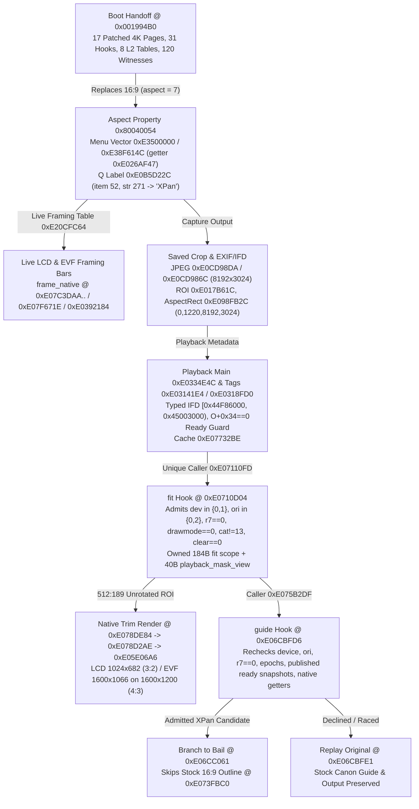

# Experimental `xpan-crop` Architecture (`2.71:1` XPan Preview & Output)

> [!WARNING]
> **Experimental Source Preview — Original Canon EOS R5 Firmware `2.2.1` Only**
> - `--profile xpan-crop` is **intentionally silent (no audio)** and disables added shutter playback (`play_shutter = 0`, zero PCM assets or `puff` linked). The headless control/report worker remains active; Canon's own Beep setting is unchanged.
> - **Evidence boundary:** Private prior candidate `466ca8fe` (`source_id=c9f06053c82fdfe3`) had user-confirmed immediate black bars on rear LCD landscape first-open playback (`DbgRA127`), live LCD/EVF framing bars, Quick Control `"XPan"` label, `8192x3024` Large JPEG and `8192x5464` CR3 crop `(0, 1220, 8192, 3024)` output, and normal photos without errors.
> - **Latest `4838eb81` (`source_id=427bb28d5d188f6b`) portrait/EVF extension is software/ROM/ABI-verified only** (`device in {0, 1}`, `orientation in {0, 2}`, effective `rotation r7 == 0`) — **no physical camera test has been run on `4838eb81` or the public repackaged build.**

---

## 1. Crop Geometry & Menu Replacement

- **Replaces `16:9` (no extra menu slot):** Hooks Canon's `PROP_IMAGE_ASPECT_RATIO` (`0x80040054`) aspect slot `7` (`16:9`) in live framing, saved JPEG/RAW metadata, playback masking, and the Quick Control (`Q`) / menu indicator.
- **Exact aspect ratio:** `512:189` (`~2.70899:1`), a pixel-aligned approximation of the XPan film frame's `65:24` ratio.
- **Large JPEG output:** `8192 x 3024` pixels (`8192 * 189 / 512 = 3024`).
- **CR3 RAW output:** Full sensor `8192 x 5464` logical canvas with centered crop box `(x=0, y=1220, w=8192, h=3024)` recorded in RAW/IFD crop metadata.
- **Unverified / uncovered qualities & modes:** Other still qualities (M/S/C-RAW and other RAW/JPEG combinations), continuous burst, and movie mode are not certified and require separate test coverage.

---

## 2. R5 `2.2.1` End-to-End Pipeline & Addresses



### Key Runtime Safety Invariants

1. **No Global Viewport or Direct VRAM Writes:** `fit` (`0xE0710D04`) only updates the caller's `[sp+8]` unrotated source ROI (`[0, 1220, 8192, 3024]` for selector `0`, scaled proportionally for selectors `1` and `2`). Canon's native `GRAPHICS_DrawOneImageForTrimImage` (`0xE078DE84`) handles destination LCD (`1024x682`) and EVF (`1600x1200` / `1600x1066` trim) rendering without stretching.
2. **Playback Readiness & Private View Key:**
   - `playback_native.c` validates `O+0x34 == 0` (`imageState == 0` ready guard) on `MAIN_END` and `CACHE` before admitting a file's `[7, 8192, 3024, 0, 1220]` (RAW) or `[7, 8192, 3024, 0, 0]` (JPEG) crop tuple, avoiding false positives from failed/pending image handles.
   - `ifd_memory.c` admits typed IFD handles in `[0x44F86000, 0x45003000)` with verified L1 supersections (`0x44054402` / `0x45054402`) without weakening generic `frame_memory_data_span` (`< 0x40000000`).
   - `playback_mask_view` (`40` bytes, 8-byte aligned, seqlock-protected) binds `(ready_revision, object_revision, cache_revision, category, device, orientation, rotation=0)`. Any LCD/EVF switch, orientation change, rotation change, or object/cache epoch change between `fit` and `guide` (`0xE06CBFD6`) invalidates the candidate and restores stock behavior.
3. **Admitted vs. Declined Playback Views:**
   - **Admitted (`r7 == 0`, `drawmode == 0`, `category != 13`, `clear_color == 0`):**
     - `(device=0, orientation=0)`: Rear LCD landscape — **hardware-confirmed in prior `466ca8fe` (`DbgRA127`)**
     - `(device=0, orientation=2)`: Rear LCD portrait (Auto-Rotate Off / Computer-Only, effective `r7 == 0`) — **software-only in `4838eb81`, hardware-untested**
     - `(device=1, orientation=0)`: EVF landscape — **software-only in `4838eb81`, hardware-untested**
     - `(device=1, orientation=2)`: EVF portrait (effective `r7 == 0`) — **software-only in `4838eb81`, hardware-untested**
   - **Declined:** `device >= 2` (HDMI/external), `orientation not in {0, 2}` (`1`, `3`, `0x5a`, etc.), active auto-rotation (`r7 != 0`), `drawmode != 0`, `category == 13`, non-black clear color, `O+0x34 != 0`, and legacy `16:9` files.

---

## 3. Build-Time ROM Derivation & Diagnostic Verification

`python3 tools/build.py --profile xpan-crop` embeds **no Canon ROM pages or binaries** in the repository. Instead, `tools/contracts.py` (`admit_xpan_rom_with_provenance`) first verifies:

- Exact `64 MiB` dump size and `0xE0100000..0xE0140000` word-sum `0x22C94093`
- All `25` base R5 `2.2.1` code fingerprints + `7` startup patch opcodes
- All `128` XPan 4 KiB code/table pages, `3` boot MMU table slices (`0xE0000080`, `0xE0003800`, `0xE0004840`), `31` hook windows, the `3,360`-byte framing table (`0xE20CFC64`), and the `968`-byte stock menu vector resource (`0xE38F614C`)

Only after those immutable checks pass does the builder derive into `--output`:
- `target-page.bin` (`0xE0100000` virgin boot shadow page)
- `frame-row/frame_row_constants.h` (projected `1600/2439` display rows from `0xE20CFC64`)
- `menu-vector.bin` (`680`-byte `"XPan"` OpenVG resource combining stock `0xE38F614C` timeline/style envelope with clean-room `xpan_font.json`)
- `feature-targets.h` / `feature-config.h` (page checksums and `31` hook patches)

After building, you can optionally export and verify all host C models and ELF layouts against your build directory:

```sh
python3 src/experimental/xpan/tools/make_q_label_runtime_contract.py build/my-r5-xpan
```

Diagnostic KUWA RAM exports (`DbgRA*.bin`, `262,144` bytes) from developer sessions can be decoded offline against `build/my-r5-xpan/framing-runtime-contract.json`:

```sh
python3 src/experimental/xpan/tools/playback_log.py path/to/DbgRA001.bin --contract build/my-r5-xpan/framing-runtime-contract.json
```
