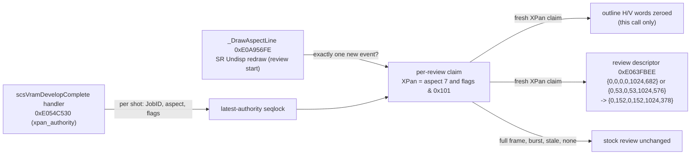
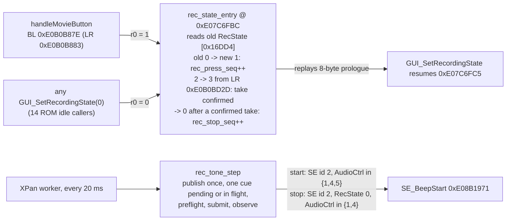

# Experimental `xpan-crop` Architecture (`2.71:1` XPan Preview & Output)

> [!WARNING]
> **Experimental Source Preview — Original Canon EOS R5 Firmware `2.2.1` Only**
> - `--profile xpan-crop` is **silent by default (no audio)** and disables added shutter playback (`play_shutter = 0`, zero PCM assets or `puff` linked). The headless control/report worker remains active; Canon's own Beep setting is unchanged. The only sounds it can add are the opt-in [movie record indicator](#4-opt-in-movie-record-indicator---record-indicator) cues (`--record-indicator` and `--record-stop-indicator`, both off by default).
> - **Evidence boundary:** Private prior candidate `466ca8fe` (`source_id=c9f06053c82fdfe3`) had user-confirmed immediate black bars on rear LCD landscape first-open playback (`DbgRA127`), live LCD/EVF framing bars, Quick Control `"XPan"` label, `8192x3024` Large JPEG and `8192x5464` CR3 crop `(0, 1220, 8192, 3024)` output, and normal photos without errors.
> - **Private `4838eb81` (`source_id=427bb28d5d188f6b`) normal ▶ playback was reported working in the owner's four-case session on 17 November 2026** (`device in {0, 1}`, `orientation in {0, 2}`, effective `rotation r7 == 0`). Returned diagnostics support projection and guide suppression.
> - **Automatic post-shot review:** the profile now carries the review fix (§3). On private lab build `a7e92a3d` the owner reported, on 18 November 2026, immediate XPan bars with the 16:9 outline hidden for XPan shots only, a stock review for Full-frame shots and bursts, and normal EVF bars. Older builds without the fix (including public `18f2c774`) show the 16:9 outline first. The public `xpan-crop` + `ding` build (`05e9612`) passed a short owner check of this review behaviour on 18 November 2026.
> - **JPEG-only (RAW off) automatic review ([#31](https://github.com/WhiteAvocad0/canon-r5-mod/issues/31)): fixed.** The profile steers this review onto Canon's aspect-correct route (§3.1). On 23 November 2026 the owner checked the public release-candidate image `e2e7048d`, which has the same code as this version, on a 128 GB card. A fresh-boot check gave two correct JPEG-only XPan reviews, and a full repeat of a long session ended with three correct ones. One JPEG-only review late in the first long session was stretched; that has not been reproduced and remains an open observation (§3.1). M/S JPEG, bursts and the EVF review keep the stretched stock review.

---

## 1. Crop Geometry & Menu Replacement

- **Replaces `16:9` (no extra menu slot):** Hooks Canon's `PROP_IMAGE_ASPECT_RATIO` (`0x80040054`) aspect slot `7` (`16:9`) in live framing, saved JPEG/RAW metadata, playback masking, and the Quick Control (`Q`) / menu indicator.
- **Exact aspect ratio:** `512:189` (`~2.70899:1`), a pixel-aligned approximation of the XPan film frame's `65:24` ratio.
- **Large JPEG output:** `8192 x 3024` pixels (`8192 * 189 / 512 = 3024`).
- **CR3 RAW output:** Full sensor `8192 x 5464` logical canvas with centered crop box `(x=0, y=1220, w=8192, h=3024)` recorded in RAW/IFD crop metadata.
- **Unverified / uncovered qualities & modes:** Other still qualities (M/S/C-RAW and other RAW/JPEG combinations), continuous burst, and movie mode are not certified and require separate test coverage.

### Stored Crop Tags

The relevant MakerNote is **`0x009a` AspectInfo**, five unsigned 32-bit words: `(aspect, width, height, left, top)`. Returned XPan RAW files contain `[7,8192,3024,0,1220]`; the physically cropped JPEGs contain `[7,8192,3024,0,0]`. These match the native playback classifier in `playback_box.c`.

In ExifTool, query **`CroppedImageLeft` / `CroppedImageTop`** for this structure. **`CropTopMargin` belongs to the separate `0x0098` CropInfo structure**; a value of 0 in RAW or 352 in JPEG is not the AspectInfo crop origin. The JPEG CropInfo value was also present in the stock 16:9 comparison. See [ExifTool 13.55's Canon definitions](https://github.com/exiftool/exiftool/blob/13.55/lib/Image/ExifTool/Canon.pm#L7163-L7198). The Canon aspect enum remains 7, so a metadata reader may label it 16:9 even though the stored dimensions carry the wide crop. Third-party RAW-editor crop handling has not been validated.


---

## 2. R5 `2.2.1` End-to-End Pipeline & Addresses


### Key Runtime Safety Invariants

1. **No Global Viewport or Direct VRAM Writes:** `fit` (`0xE0710D04`) only updates the caller's `[sp+8]` unrotated source ROI (`[0, 1220, 8192, 3024]` for selector `0`, scaled proportionally for selectors `1` and `2`). Canon's native `GRAPHICS_DrawOneImageForTrimImage` (`0xE078DE84`) handles destination LCD (`1024x682`) and EVF (`1600x1200` / `1600x1066` trim) rendering without stretching.
2. **Playback Readiness & Private View Key:**
   - `playback_native.c` validates `O+0x34 == 0` (`imageState == 0` ready guard) on `MAIN_END` and `CACHE` before admitting a file's `[7, 8192, 3024, 0, 1220]` (RAW) or `[7, 8192, 3024, 0, 0]` (JPEG) crop tuple, avoiding false positives from failed/pending image handles.
   - `ifd_memory.c` admits typed IFD handles in `[0x44F86000, 0x45003000)` with verified L1 supersections (`0x44054402` / `0x45054402`) without weakening generic `frame_memory_data_span` (`< 0x40000000`).
   - `playback_mask_view` (`40` bytes, 8-byte aligned, seqlock-protected) binds `(ready_revision, object_revision, cache_revision, category, device, orientation, rotation=0)`. Any LCD/EVF switch, orientation change, rotation change, or object/cache epoch change between `fit` and `guide` (`0xE06CBFD6`) invalidates the candidate and restores stock behavior.
3. **Admitted vs. Declined Playback Views:**
   - **Admitted (`r7 == 0`, `drawmode == 0`, `category != 13`, `clear_color == 0`):**
     - `(device=0, orientation=0)`: Rear LCD landscape — **hardware-confirmed in prior `466ca8fe` (`DbgRA127`)**
     - `(device=0, orientation=2)`: Rear LCD portrait (Auto-Rotate Off / Computer-Only, effective `r7 == 0`) — **reported working in the owner's normal ▶ session on private `4838eb81`**
     - `(device=1, orientation=0)`: EVF landscape — **reported working in the owner's normal ▶ session on private `4838eb81`**
     - `(device=1, orientation=2)`: EVF portrait (effective `r7 == 0`) — **reported working in the owner's normal ▶ session on private `4838eb81`**
   - **Declined:** `device >= 2` (HDMI/external), `orientation not in {0, 2}` (`1`, `3`, `0x5a`, etc.), active auto-rotation (`r7 != 0`), `drawmode != 0`, `category == 13`, non-black clear color, `O+0x34 != 0`, and legacy `16:9` files.

---

## 3. Hardware Follow-Up and Automatic Post-Shot Review

On 17 November 2026, the owner reported that the instructed four-case first-open normal ▶ session worked: rear-LCD landscape and portrait, then EVF portrait and landscape, plus Full-frame/display-switch checks. This is an aggregate visual report, not an instrumented per-case latency measurement. The returned payload was the exact private `4838eb81` image, not public `18f2c774`.

All four complete playback reports show crop projection and guide suppression. Three first-view reports are complete; one is incomplete at the log ring boundary, so its missing detail remains unknown. Two additional portrait RAW/JPEG pairs were returned, with JPEG dimensions 8192×3024 and full RAW dimensions 8192×5464.

**Automatic post-shot review is a separate path from normal ▶ playback.** Without the fix, the rear LCD shows Canon's 16:9 outline first and XPan bars about one second later (owner report on the `4838eb81` reference, not instrumented). The public `xpan-crop` profile now includes the fix below by default; there is no option to turn it off.



- **Authority (passive).** `xpan_authority` observes the handler that logs `scsVramDevelopComplete(JobID)` and then permits the simple review. It validates the Job handle signature `0xE2083738`, then reads JobID `[obj+0x3C0]`, aspect `[obj+0x14C0]` and image-type flags `[obj+0x19F0]` inside admitted RAM spans, and publishes them as the single latest record.
- **Gate.** The review starts at the SR Undisp redraw (`Background_Draw` caller `0xE0A957CB` from `0xE05FDF6D`, SR flag `[0x17268] == 1`, display `0`, force `1`). That review claims the newest event only if exactly one event arrived since the previous review. A burst gives `MULTIPLE` and the stock review. The claim is XPan only for aspect `7` with a Large JPEG (`flags & 0x101`). A newer event during the review revokes it; leaving SR closes it.
- **Outline.** For an admitted XPan claim, a matching rear-LCD call (GUI aspect `[[0x171DC]+0x18C0] == 7`, Canon's own decision H=1/V=0) gets its two caller-local decision words zeroed, so Canon takes its own no-line path. The 10-byte prologue is replayed exactly.
- **Descriptor crop.** At the completed `0xE063FBEE` copy for caller `0xE063BECF`, an active, kind-0, 1024x682 descriptor with exactly the full-source tuple (RAW + JPEG) or exactly Canon's stock 16:9 letterbox tuple `{0,53,0,53,1024,576}` (JPEG only) gets three words changed, giving the centred `512:189` band (378 of 682 rows). Any other descriptor, and every refused gate decision, leaves it untouched.
- **Diagnostics.** Decisions are kept as `.bss` counters only. No report rows are emitted and the lab's per-decision diagnostic records are not ported.
- **Scope and limits.** Verified on the private lab build only (see the evidence note above). Bursts deliberately keep the stock review (no bars), and an in-review redraw after a newer shot falls back to stock. Other qualities and modes follow the same unverified/declined list as playback. The public `xpan-crop` + `ding` build passed a short owner check on 18 November 2026.

### 3.1 JPEG-only review ([#31](https://github.com/WhiteAvocad0/canon-r5-mod/issues/31))

With RAW off, the simple review (SR) shows the bars, then Canon's Quick Review (QR) redraws the saved `8192x3024` JPEG through the playback fit (`0xE0710D04`, caller `0xE071106E`, category `7`, selector `0`) and leaves it stock (result `0`, region `{0,0,0,0}`). The caller then picks its draw route from its 5th argument, kept in `r8`:

- `r8 == 1` (`0xE0711116 cmp.w r8,#1`): `0xE078DDC8`, whose renderer places the decoded buffer by Canon's five-class aspect table (3:2, 4:3, 16:9, 1.896:1, 1:1). A `2.71:1` buffer lands in the 1:1 row, which is the vertical stretch. This route also caps the decode at about 4 MB (`2048x756` was observed).
- otherwise: `0xE078DD3E`, which draws the whole decoded buffer aspect-correct inside the review viewport, the route the RAW + JPEG review takes.

The fix, in three parts that need no new hook, page or witness:

1. **Letterbox.** The review crop above also accepts Canon's 16:9 tuple of the JPEG-only review, so SR shows the same XPan band.
2. **Review token.** Each applied crop records which review it was for: a letterbox crop keeps the gate claim's ordinal, a full-source crop clears it. The SR flag has already closed the claim when QR draws, so the fit asks `xpan_review_gate_event_current` instead. It admits only while that shot is still the newest authority event, a Job of aspect `7` with a Large JPEG and no RAW bit (`flags & 0xF00000 == 0`). The check only reads. The token lasts for that shot's QR redraws and ends at the next shot.
3. **Route.** The fit admits exactly that QR call: frame and view checks as for RAW_L, selector `0`, category `7`, object and cache `JPEG_L [7,8192,3024,0,0]`, `8192x3024`, plus the token. Canon's native getters refuse a region for a JPEG that is already the crop, so the store is never made and fit still returns Canon's `0`. When Canon's result is `0`, the stock region is all zero, the object and view are unchanged, and the caller's `r8` is `1`, `fit_end` writes `0` into the `r8` word of our own trampoline frame (`scope + 184 + 8 + 4*8`). `restore_cpu` reloads it, and the caller takes `0xE078DD3E`. Nothing else is written. `r8` is read only at `0xE0711116` and restored by the caller's own `ldmia` at `0xE071115C`; these three words (`0xE071107C`, `0xE0711116`, `0xE071115C`) are pinned in `playback-mask-hooks.json` and lie in the fingerprinted guard page `0xE0711000`.

**Evidence boundary.** The public release-candidate image `e2e7048d` (`--record-indicator ding --record-stop-indicator dong --screenshot rate`) was owner-checked on a 128 GB card on 23 November 2026. Every object of this version's build with those options compiles to the same code; only the source digest text differs. This exact image was not separately camera-run.

- **First session:** everything else worked, but one JPEG-only XPan review, late in a long session, was stretched. It has not been reproduced since. It remains an open observation.
- **Fresh-boot check:** two JPEG-only XPan photos, both reviewed correctly.
- **Full repeat of the long session:** boot, a movie, two 3:2 photos, screenshots with the automatic INFO, a joystick cancel, RATE in ▶, two quick RAW+L XPan photos, then three JPEG-only XPan photos. The owner reported everything working.

Private lab builds 37 (`6b8da720`) and 39 carry the same fix plus logging. Their logs on the owner's camera showed the steered draw route on every JPEG-only XPan review, after screenshots, after two RAW+L XPan photos and in movie mode; build-37 also logged an `8192x3024` decode. The public port drops the lab's diagnostic recorders. Other option combinations are hardware-untested with this change.

**Expected to stay stretched (stock review):**

- **M and S JPEG** XPan: the gate needs a Large JPEG, so there is no claim, no letterbox and no token.
- **Bursts:** more than one new shot per review gives `MULTIPLE` and the stock review.
- **EVF review:** the EVF review descriptor is not the cropped kind, so it never arms the token (untested on a camera).
- Any review the gate refuses, and a QR redraw after a newer shot.

## 4. Opt-In Movie Record Indicator (`--record-indicator`)

`--record-indicator {off,ding,chirp2,2k150loud}` adds issue [#14](https://github.com/WhiteAvocad0/canon-r5-mod/issues/14)'s start cue on the Movie REC press, and `--record-stop-indicator {off,dong}` its stop cue once per ended take. They are independent and both default to `off`. With both `off`, none of the parts below is linked and admission checks exactly the default pages; either one links all of them except the other cue's buffer. Usage, cues and the evidence boundary are in [docs/usage.md](usage.md#movie-record-indicator---record-indicator).



- **Hook (counter only).** The 8-byte `GUI_SetRecordingState` prologue `10b5 0446 0346 0321` has no PC-relative instruction and no interior branch target. The hook increments two counters (REC presses, ended takes) and keeps one latch: a take is confirmed by the normal start `2 -> 3` from LR `0xE0B0BD2D` and ends at the next idle (`0`) set from any caller, once. It touches no audio. Its page (`0xE07C6000`) and two guard pages (`0xE0A98000`, the RecState accessor; `0xE0B0B000`, the movie-button callers) are admitted through `record_indicator_code_fingerprints` in `config/xpan_target_contract.json` and checked again at boot as source witnesses.
- **Cue buffers.** `tone_gen_fill` renders each selected cue once on the first worker tick into its own 32-byte-aligned BSS buffer (`rec_tone_cues` lists them; an unselected cue is all zero). Every buffer is cleaned before any descriptor pointer is set, and nothing is written again. Any fault leaves every pointer at 0.
- **Submission.** The preflight is a port of `audio.S`'s readiness and dependency checks with one change: AudioCtrl states 1, 4 and 5 are admitted (5 is audio recording). SE id 2 skips the PCM worker's "Movie Playing" gate. A busy speaker or another AudioCtrl state is retried for up to 10 ticks; then the cue is dropped. A start cue still pending outside RecState `{1, 2, 3}` is dropped and never replayed. The stop cue is submitted only while RecState is `0` and only in AudioCtrl states 1 and 4: its own retry mask always waits out state 5 (the record path) within the same 10 ticks.
- **One cue at a time.** Only one cue is pending or in flight. Events that arrive while a cue is observed are counted and dropped, never queued. An ended take drops a pending start cue, and a new press drops a pending stop cue; when both land in one tick the newer press wins. Without a start cue the worker never reads the press counter, and without a stop cue it never reads the ended-take counter.
- **Observation.** The step follows ABeep's phase and recognises its own buffer by pointer and byte count: settled, stopped (cut by a Canon sound), rejected (confirmed on a second tick) or timeout after 25 ticks. A timeout disables further cues until power-off.
- **Capacity.** With either or both cues the build has `35` hooks, `21` pages, `10` L2 tables and `139` source witnesses, the same inventory as the private lab build. The default build has `34/20/10/137`. Each selected cue reserves its own buffer (24,000 bytes for `ding` or `dong`); the linked check refuses an image below Canon's heap floor.

Not ported from the private lab build: the 2-cue A/B start rotation, the `request`/`confirmed` start triggers, per-attempt before/after report rows and the movie-limit diagnostic. Changed from it: the stop cue may be selected without a start cue, and it always waits out AudioCtrl state 5 (the lab build did so only with the `press` and `request` triggers).

## 4b. Opt-In One-Press Screenshot (`--screenshot`)

`--screenshot {off,rate}` (default `off`) adds issue [#15](https://github.com/WhiteAvocad0/canon-r5-mod/issues/15)'s one-press screenshot: RATE in ▶ saves a 2400×1600 JPEG of the whole screen through Canon's own Resize job and JPEG encoder; RATE in live view or a menu saves the screen and makes the JPEG in ▶, through an INFO press the camera posts 2 s after ▶ opens (or INFO by hand), and an XPan photo is replaced by the last good photo of the session. It adds three hooks (GUI dispatch `0xE04A8028`, ShtVfxEncJpg_Encode `0xE0CCB284`, INDEV_DevelopEnd `0xE0549258`), whose pages and the pages of every Canon function the feature calls are admitted through `screenshot_code_fingerprints` only when it is selected. A screenshot build has `37` hooks, `23` pages and `11` L2 tables (`38/24/11` with the record indicator); with `off`, none of it is linked. Use, sounds, files and the evidence boundary are in [docs/screenshot.md](screenshot.md).

## 5. Build-Time ROM Derivation & Diagnostic Verification

`python3 tools/build.py --profile xpan-crop` embeds **no Canon ROM pages or binaries** in the repository. Instead, `tools/contracts.py` (`admit_xpan_rom_with_provenance`) first verifies:

- Exact `64 MiB` dump size and `0xE0100000..0xE0140000` word-sum `0x22C94093`
- All `25` base R5 `2.2.1` code fingerprints + `7` startup patch opcodes
- All `148` XPan 4 KiB code/table pages, `3` boot MMU table slices (`0xE0000080`, `0xE0003800`, `0xE0004840`), `34` hook windows (plus `3` pages and `1` hook with `--record-indicator` and/or `--record-stop-indicator`, and `25` pages and `3` hooks with `--screenshot rate`), the `3,360`-byte framing table (`0xE20CFC64`), and the `968`-byte stock menu vector resource (`0xE38F614C`)

Only after those immutable checks pass does the builder derive into `--output`:
- `target-page.bin` (`0xE0100000` virgin boot shadow page)
- `frame-row/frame_row_constants.h` (projected `1600/2439` display rows from `0xE20CFC64`)
- `menu-vector.bin` (`680`-byte `"XPan"` OpenVG resource combining stock `0xE38F614C` timeline/style envelope with clean-room `xpan_font.json`)
- `feature-targets.h` / `feature-config.h` (page checksums and `34` hook patches, `35` with the indicator)

After building, you can optionally export and verify all host C models and ELF layouts against your build directory:

```sh
python3 src/experimental/xpan/tools/make_q_label_runtime_contract.py build/my-r5-xpan
```

Diagnostic KUWA RAM exports (`DbgRA*.bin`, `262,144` bytes) from developer sessions can be decoded offline against `build/my-r5-xpan/framing-runtime-contract.json`:

```sh
python3 src/experimental/xpan/tools/playback_log.py path/to/DbgRA001.bin --contract build/my-r5-xpan/framing-runtime-contract.json
```
